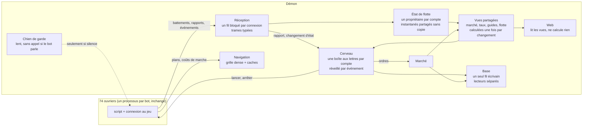

# LifeScape — plan d'architecture, de navigation et de CPU

Analyse et plan seulement : aucun code modifié, aucun build, aucune commande sur la flotte.
Date : nuit du 23 au 24 novembre 2026, dépôt au commit `66a32cd` (découpage en 10 crates).

Vocabulaire utilisé dans ce document :

- **démon** : le processus `orchestrator daemon` qui pilote toute la flotte.
- **ouvrier** : le processus `orchestrator session <compte>`, un par bot.
- **cerveau** : la partie du démon qui décide quoi lancer (crates `planner` et `orch-brain`).
- **passe** : un passage du cerveau sur un bot.
- **cœur** : un cœur de processeur. « 0,5 cœur » veut dire la moitié d'un cœur occupée en permanence. La machine en a 8.
- **verrou** : protection qui empêche deux fils d'exécution de toucher la même donnée en même temps.
- **singleton** : donnée globale unique, accessible de partout dans le programme.

---

## 0. L'essentiel

1. **Le démon consomme entre 1,2 et 2,5 cœurs** pour 74 bots (mesuré cette nuit : 1,2 à 1,6 sans tableau de bord ouvert, 2,5 avec un onglet juste après un redémarrage), soit 1,6 à 3,4 % d'un cœur par bot. La décision D36 visait 0,33 % par bot. Les 74 ouvriers réunis ne coûtent que 0,33 à 0,44 cœur, et le serveur de jeu 0,45 cœur.
2. **Le modèle « un processus par bot » n'est pas le problème.** La décision du 10 novembre (E7) reste juste, et je recommande de la garder. Le coût est dans le démon.
3. **Quatre postes font presque tout le CPU du démon** : le cerveau (0,5 à 1,2 cœur), la navigation (0,5 à 0,7 cœur), le tableau de bord ouvert dans un navigateur (0,2 à 0,4 cœur par onglet), la réception des battements des ouvriers (0,07 cœur).
4. **Le cerveau refait le même travail des centaines de fois par passe.** Exemple prouvé : `brain_trade.rs:83` recopie tout l'état du bot et fait 2 requêtes en base pour chaque objet de chaque ligne du guide. La même faute a déjà été corrigée dans `brain_money.rs:254`, pas ici. Cette seule ligne pèse 0,13 cœur en moyenne sur 19 heures.
5. **La navigation paie sa structure de données, pas son algorithme.** Chaque lecture d'une case traverse un verrou et 3 à 5 tables de hachage ; chaque recherche reconstruit ses propres tables. Je propose une grille dense (tableau direct), qui donne les mêmes plans à l'octet près. Gain attendu : 5 à 10 fois moins de CPU par case visitée.
6. **Le sondage toutes les 500 ms ne tourne pas en 500 ms.** Un tour complet du superviseur prend 8 à 11 secondes. Mesuré sur 27 622 rapports : un bot attend en moyenne **8,5 secondes** entre la fin de sa tâche et la prise en compte par le cerveau. Cela représente 65 heures-bot perdues sur la période, environ 4,6 % du temps de la flotte.
7. **L'architecture cible** garde les processus, les sockets Unix et le JSON, mais passe du sondage à l'événement (un rapport réveille le cerveau tout de suite), donne à chaque donnée un seul propriétaire, et fait lire au cerveau des vues partagées calculées une fois pour toute la flotte.
8. **Ordre proposé** : mesurer, corriger les gaspillages sûrs (environ −0,4 à −0,6 cœur en quelques lots courts), puis la navigation, puis la réactivité, puis les vues partagées du cerveau, puis les frontières typées.
9. **Le défaut des bancs d'équivalence** (celui qui a laissé passer la panne du 23 novembre) n'est pas fermé : `brain_launch_inputs.rs:44` finit encore par `..LaunchInputs::default()`, donc un champ ajouté demain sera de nouveau oublié en silence. Le remède tient en une règle de compilation (section 5.3).

---

## 1. Diagnostic

### 1.1 Méthode et limites

Sources lues, toutes en lecture seule :

- `run/orchestrator.log` : 471 000 lignes, du 22 novembre 20:44 UTC au 23 novembre 23:20 UTC, dont 1 133 lignes `cpu-profile brain` et 1 136 lignes `cpu-profile nav` (une par minute, 68 171 secondes couvertes, soit 19 heures de flotte active).
- `/proc` : CPU par fil d'exécution du démon, des 74 ouvriers, du serveur de jeu, par fenêtres de 120 secondes (script `scratchpad/arch/sample.py`).
- `run/lifescape.db` ouvert en lecture seule.
- Une requête `{"op":"stats"}` sur `run/pathfinding.sock` (compteurs du service de navigation, lecture pure). Je la signale parce que ce n'est pas un GET sur le port web.
- Le code, par Repowise puis lecture directe, et trois sous-analyses (ouvrier, fils secondaires du démon, phases du cerveau) dont j'ai revérifié les points cités ici.

Trois limites à garder en tête :

- **La flotte a été arrêtée puis relancée à 00:20 (heure locale) pendant mes mesures**, par quelqu'un d'autre que moi (`orchestrator shutdown` vu dans `ps`). Le serveur de jeu a redémarré aussi. Les mesures `/proc` ci-dessous datent donc des 10 à 30 premières minutes après redémarrage, période plus chargée que la normale. Les moyennes sur 19 heures viennent du journal d'avant.
- Depuis ce redémarrage le démon tourne avec `LIFESCAPE_SERVER_HOST=172.19.0.2` (connexion directe au conteneur, sans le relais `docker-proxy`). La doc dit de rester sur `127.0.0.1` tant que le serveur n'est pas corrigé. Je ne sais pas si c'est voulu (question 6).
- Le service de navigation ne mesure pas son CPU par type de requête. Je sais combien coûte le groupe de fils `plan-query`, pas combien coûte une requête `walk_costs` seule. C'est le premier lot à faire.

### 1.2 Où part le CPU

Machine : 8 cœurs, charge moyenne 5 à 8, d'autres services tournent dessus.

| Poste | Mesure | Source |
|---|---|---|
| Démon, moyenne de vie avant l'arrêt | 1,65 cœur (29 min 15 s de CPU en 17 min 42 s) | `ps` à 00:20 |
| Démon, 7 à 9 min après redémarrage, un onglet ouvert | 2,48 cœurs | fenêtre 00:27–00:29 |
| Démon, 9 à 17 min après redémarrage, onglet fermé | 1,19 à 1,57 cœur | fenêtres 00:29–00:37 |
| 74 ouvriers réunis | 0,33 à 0,44 cœur (0,45 à 0,59 % chacun) | 5 fenêtres |
| Serveur de jeu (node) | 0,45 à 0,47 cœur, dont 0,40 sur son fil principal | 5 fenêtres |
| Relais `docker-proxy` | 0,09 cœur avant l'arrêt, 0 depuis (connexion directe) | `ps`, fenêtres |
| Mémoire | démon 614 à 880 Mo ; ouvriers 26 à 34 Mo affichés chacun, 11 à 20 Mo réellement propres à chacun | `smaps_rollup` |

Détail du démon par groupe de fils (en % d'un cœur) :

| Groupe de fils | 00:27–00:29 (un onglet ouvert) | 00:29–00:31 | 00:31–00:33 | 00:33–00:35 | 00:35–00:37 | Moyenne 19 h (journal) |
|---|---|---|---|---|---|---|
| Total du démon | 248 | 119 | 133 | 132 | 157 | — |
| `brain-tick` (4 fils, le cerveau) | 117 | 48 | 51 | 48 | 54 | 60 |
| `plan-query` (2 fils, lectures de navigation) | 49 | 34 | 31 | 50 | 60 | 46 |
| `plan-pool` (4 fils, calcul des trajets) | 18 | 15 | 13 | 13 | non relevé | 9 |
| `web-conn` (tableau de bord) | 39 | 5 (onglet fermé en cours de fenêtre) | 0,6 | 0 | 6,5 | non mesuré |
| `push-read` (réception des battements) | 6,8 | 7,8 | 9,5 | 8,6 | non relevé | non mesuré |
| `guides` | 4,1 | — | — | — | — | environ 4 |
| `market-convene` | 3,8 | 2,8 | — | — | — | non mesuré |
| `supervise-all`, `rates-flush`, `holdings-sample`, `plan-wait` | environ 2 chacun | — | — | — | — | non mesuré |
| Fils éphémères `worker-connect` | environ 12 (estimé par différence) | — | — | — | — | non mesuré |

Un tiret veut dire « sous 2 % dans cette fenêtre » ou « non relevé ».

Lecture : le cerveau et la navigation font ensemble 0,95 à 1,85 cœur, et la navigation seule dépasse parfois le cerveau (0,6 cœur sur `plan-query` dans la dernière fenêtre). Un seul onglet du tableau de bord ajoute 0,2 à 0,4 cœur. Tout le reste réuni fait 0,2 à 0,25 cœur.

Autre signal : le démon subit **77 000 changements de contexte volontaires par seconde** dans la première fenêtre, puis 10 000 à 20 000 dans les suivantes (un changement de contexte volontaire, c'est un fil qui s'endort en attendant un verrou ou une réponse). C'est le symptôme de fils qui se disputent les mêmes verrous.

### 1.3 Le cerveau

Cadence réelle. 465 526 ticks du cerveau en 68 171 s pour 74 bots : **un tick par bot toutes les 10,8 secondes**, pas toutes les 3 secondes comme le dit `PLAIN_TICK_SECS` (`brain.rs:479`). La raison est au 1.6 : le cerveau n'est réveillé que par le tour du superviseur.

Un tick sur un bot occupé ne coûte presque rien : la passe sort dès `job_idle` (`brain_launch_steps.rs:23-27`). 86 % des ticks sont dans ce cas. Les 14 % restants (environ 64 000 passes) portent tout le coût : **environ 0,64 seconde de CPU par passe utile**.

Répartition sur 19 heures (les phases sont emboîtées dans `tick.maybe_launch`, 41 014 s de CPU au total) :

| Phase | Appels | CPU total | CPU moyen par appel | Ce qui coûte |
|---|---|---|---|---|
| `trade.publish` (dans `ctx.build`) | 52 940 | 9 205 s | 174 ms (60 à 490 selon l'heure, 1 480 ms juste après redémarrage) | `brain_trade.rs:83` : pour chaque objet de chaque ligne, une copie complète de l'état du bot et 2 requêtes en base sous le verrou commun |
| `wait_answer` | 10 023 | 8 700 s | 868 ms | recopie de tous les carnets d'ordres, une requête de volume par objet candidat, par bot |
| `succession.redraw` | 1 941 | 2 091 s | 1 077 ms | retenté à chaque passe tant que rien n'est tirable (`brain_upkeep_drive.rs:395`), relit tous les ordres ouverts |
| `bids.goal_for` | 8 364 | 1 982 s | 237 ms | même calcul que `wait_answer`, le cache est consommé à l'usage |
| reste de `ctx.build` | 61 464 | 2 224 s | 36 ms | lectures répétées des verrous et de l'état |
| phases non étiquetées | — | environ 14 800 s (36 %) | — | à étiqueter (lot 0) ; suspect principal : `resize_session_inputs` à chaque choix de nœud |

Trois causes de fond, toutes de la même famille :

1. **Des données communes à toute la flotte sont recalculées par bot et par passe** : carnets du marché, volumes sur 24 heures, lignes du guide pour un vecteur de niveaux.
2. **Des données du bot sont relues plusieurs fois dans la même passe** : `locked_items` (2 requêtes en base chacune) est appelé 5 à 6 fois par passe complète, plus des centaines de fois dans `trade.publish` ; l'état vivant du bot (`live`, un arbre JSON de 35 à 85 Ko) est recopié en entier à 28 endroits du code.
3. **Tout passe par des singletons protégés par verrou** : 51 statiques `OnceLock` dans `orch-brain` (dont 46 avec verrou), 36 dans `planner` (dont 27 avec verrou), plus le verrou unique de la base du marché (`market_service.rs:465-471`). Quatre fils du cerveau se les disputent : le temps d'horloge du cerveau vaut deux fois son temps CPU (81 438 s contre 41 014 s).

Le cerveau n'appelle jamais la navigation. Les coûts de trajet du planner viennent de tables statiques. La navigation est donc un poste indépendant.

### 1.4 La navigation

Chiffres de trafic (moyenne 19 h) : 31,6 demandes de plan par seconde dont 17,9 « sauts courts » (8 cases ou moins) ; 16,9 demandes `walk_costs` par seconde (prix de marche vers plusieurs cibles) ; 2,5 plans par seconde vraiment calculés (cache raté). Taux de succès du cache de routes : 63 à 76 %.

CPU : 0,56 cœur en moyenne, dont **0,46 sur les 2 fils `plan-query`** et 0,09 sur les 4 fils de calcul. Le 14 novembre, la prévision après optimisation était de 1,1 s de CPU par minute pour toute la navigation ; on mesure aujourd'hui 29 à 46 s par minute, soit 30 fois plus. Le trafic a un peu augmenté (74 bots au lieu de 60), pas d'un facteur 30. Quelque chose sur `plan-query` coûte beaucoup plus que dans le rejeu de l'époque, et l'outillage actuel ne dit pas quoi.

Ce que le code montre :

- **Lecture d'une case** (`static_world.rs:75-96`) : un verrou lecture-écriture, puis `has_square` (table de hachage), `is_loaded`, `collision.get` (`loc_collision.rs:28-46`, `HashMap<u32, [u32; 64]>` avec le hachage lent par défaut), `npc_blockers.contains`. Soit 3 à 5 recherches par hachage pour lire un entier.
- **Chaque recherche reconstruit sa mémoire** (`plan.rs:678-690`) : quatre tables (`base_flags`, `open_flags`, `doors`, `f2p_zones`) qui partent vides, plus `dist` et `prev`. La première lecture « porte ouverte » d'une case interroge les 9 cases voisines.
- **Par case visitée**, la boucle (`plan.rs:805-1079`) fait pour chacun des 8 voisins : `in_bounds`, `usable_door` (deux à trois fois), `step_closed`, `danger.extra`, `leaf_step_extra`, puis `step_open`. Coût mesuré dans la doc : 1,6 à 4,9 microsecondes par visite.
- **Le même moteur est écrit deux fois** : `costs.rs:66-190` recopie la structure `Search` de `plan.rs`. S'y ajoutent `fast_hop.rs`, `pocket.rs` et `bfs.rs`, chacun avec sa propre boucle.
- **`walk_costs` explore jusqu'à l'horizon quand une cible n'est pas atteinte** (`costs.rs:44-54` : horizon = 64 + 4 × distance de la cible la plus lointaine). Une approche d'arbre ou de rocher dont une case d'accès est derrière une clôture balaie un disque de 64 cases de rayon, soit 5 000 à 13 000 visites, 10 à 30 ms.
- **Le cache des `walk_costs` côté service ne sert à rien** : 32 succès sur 3 010 demandes (1 %) relevés cette nuit. Sa clé contient la case exacte de départ (`service.rs:180-190`).
- **Deux files seulement** pour toutes les lectures (`service_accept.rs:21`, `QUERY_THREADS = 2`). Quand les deux sont prises par des recherches de 30 ms, les sauts courts attendent. Sur un bot (tim_ford, 1 039 plans en 10 heures) : médiane 1 ms, 90 % sous 134 ms, 1 % au-dessus de 1 081 ms, maximum 2,26 s.
- **Une connexion et un fil d'exécution par requête** côté ouvrier (`service.rs:1922-1941`, `service_wait.rs:48-54`).

Structure : `Service` (`service.rs:332-392`) est un objet fourre-tout. Il porte 10 verrous, une trentaine de compteurs, la file, les caches, la socket et 52 méthodes sur 1 240 lignes. `dijkstra` a une complexité cyclomatique de 60 (60 chemins indépendants dans une seule fonction), `plan_costs_capped` 62, `reach_wall` 87.

### 1.5 Les autres postes du démon

**Tableau de bord** (`web_ws.rs:121-150`, `web.rs:32`). Pour chaque onglet ouvert, chaque seconde : la commande `status` appelle `describe()` sur les 74 bots, qui recopie l'état complet de chacun (35 à 85 Ko), puis n'en garde qu'une poignée de champs. Mesuré : 0,39 cœur pour un onglet dans la fenêtre chargée, 0,20 dans une autre. Zéro quand aucun navigateur n'est connecté.

**Réception des battements** (`push_hub.rs:180-186`, `daemon.rs:519-545`). Un seul fil interroge les 74 connexions toutes les 20 ms, soit 3 700 lectures par seconde même quand rien n'arrive. Pour chaque trame : analyse du JSON, puis **re-sérialisation complète juste pour compter les octets** (`daemon.rs:520`), puis copie complète de l'instantané (`daemon.rs:537`). Coût : 0,07 cœur.

**L'instantané complet pèse 35 à 85 Ko dont 93 % pour la trace de déplacement** (`trail`, jusqu'à 4 000 positions, `session.rs:261-267`). Elle est envoyée toutes les 6 secondes par bot actif, analysée, re-sérialisée, copiée, puis réécrite sur disque avec synchronisation forcée (`run/users/<compte>.json`, 2,5 fichiers par seconde). Le démon écrit 500 à 560 Ko par seconde sur disque.

**Superviseur** (`supervise.rs:91-208`). Peu de CPU (2 %), mais chaque appel `status` crée un fil `worker-connect` côté démon (`daemon_conn.rs:21-44`) et un fil `session-conn` côté ouvrier (`session.rs:691-697`). Les fils éphémères du démon consomment environ 0,12 cœur (estimé par différence entre le total du processus et la somme des fils vivants).

**Guides** : 10 à 12 secondes de CPU toutes les 300 secondes, soit 0,04 cœur.

**Disque** :

- `run/lifescape-staging.jsonl` : **661 Mo, jamais lu par personne**. Vestige d'un lot antérieur (`store_queue.rs:2-3` parle d'un import « futur »). Il est écrit avec synchronisation forcée depuis le fil qui reçoit les battements.
- `run/failures/` : 31 070 fichiers, jamais purgés (4 400 nouveaux par jour).
- Base : table `orders` de 1 457 198 lignes dont 1 315 589 annulées, jamais purgées (108 Mo sur 287).
- `run/rates-snapshot.json` : 13 Mo réécrits en entier chaque minute (0,4 s de CPU).
- SQLite tourne en mode `synchronous=FULL` (valeur par défaut, jamais réglée) : chaque écriture isolée force une synchronisation disque. L'attente disque de la machine est de 17 à 32 % d'un cœur.

**Journal** : 4,9 lignes par seconde, coût négligeable. À noter : le bot `rae_stone` écrit à lui seul 21 000 lignes dans une boucle de 5 lignes (« resolve … -> None », « milestone … set aside », « goal produce raw_anchovies … »). C'est un défaut de comportement à regarder, hors de ce plan.

### 1.6 Le superviseur et la réactivité

Le superviseur dort 500 ms puis fait, pour chaque bot l'un après l'autre, un appel `status` bloquant (`supervise.rs:237-250`). L'ouvrier n'accepte une connexion qu'une fois par tour de sa boucle, qui dort **100 ms quand un script tourne et 1 000 ms au repos** (`session.rs:53-54`, `session.rs:712`). Un tour complet sur 74 bots prend donc plusieurs secondes.

Or c'est ce tour qui remet les rapports de tâche au cerveau (`supervise.rs:179-208`), alors que le rapport est arrivé au démon en moins de 20 ms par le canal des battements.

Mesure sur le journal (délai entre la ligne « task_report … (push) » et la ligne « folded report » du même bot) :

| Délai | Nombre | Moyenne | Médiane | 90 % sous | 99 % sous |
|---|---|---|---|---|---|
| rapport reçu → pris en compte par le cerveau | 27 622 | 8,5 s | 7 s | 16 s | 31 s |
| pris en compte → lancement suivant | 18 983 | 10,7 s | 1 s | 8 s | 165 s |

Le premier délai, à lui seul, représente 65 heures-bot sur la période, soit 4,6 % du temps de la flotte passé à ne rien faire en attendant d'être remarqué. Le second mélange de vraies attentes (achat en cours) et de file d'attente derrière des passes lentes.

### 1.7 Les ouvriers

Un ouvrier coûte 0,45 à 0,59 % d'un cœur, 4 fils, dont un quart en appels système. Ce qui se répète à chaque tick de jeu (16,7 par seconde) :

- `publish_tick` recopie toute la trace (2 000 à 4 000 positions) à chaque pompage (`session.rs:267`) et reconstruit le cache de la banque (`session_report.rs:104-120`).
- `available()` bascule la socket en non bloquant puis en bloquant à chaque trame (`connection.rs:704-722`) : 3 appels système par vérification.
- `observe_ledgers` reconstruit sac, tables et expérience à chaque trame d'information joueur (`client/mod.rs:585-609`).
- L'instantané complet toutes les 6 secondes : parcours de tous les objets et PNJ proches, tris, sérialisation de 35 à 85 Ko.

Le potentiel est modeste : 0,1 à 0,15 cœur sur les 74 ouvriers réunis.

### 1.8 Le serveur de jeu

0,45 cœur, dont 0,40 sur le fil principal de node. C'est le coût du serveur pour simuler 74 joueurs à 60 ms par tick. Les bots envoient au plus un paquet par 70 ms chacun (`connection.rs:733-738`). Je n'ai pas trouvé de trafic inutile côté bots qui chargerait le serveur. Ce poste ne baisse qu'en touchant au serveur (hors périmètre) ou au nombre de bots.

Le relais `docker-proxy` coûtait 0,09 à 0,17 cœur. Il est contourné depuis le redémarrage de 00:20.

### 1.9 Structure du code

| Constat | Preuve |
|---|---|
| Objets fourre-tout | `nav::Service` (1 240 lignes, 52 méthodes), `sdk::Bot` dans `travel.rs` (1 067 lignes, 33 méthodes), `MarketService` (608 lignes, 21 méthodes), `sdk::World` (679 lignes) |
| Fonctions trop ramifiées | `reach_wall` 87, `map_method` 82, `resolve_obtain` 71, `handle_get` 64, `plan_costs_capped` 62, `dijkstra` 60, `handle_report` 52 |
| État en texte libre | `JobInner.phase: String`, `status: String`, `live: Option<Value>` (`jobs.rs:34-58`) ; 86 fonctions des crates `orch-*` rendent `Result<_, String>` ; le cerveau reconnaît un refus de lancement au préfixe `busy:` du message |
| Singletons | 51 dans `orch-brain`, 36 dans `planner`, 12 dans `orch-stats` |
| Dépendances remontantes restantes | `orch-web` et `orch-daemon` dépendent de `orch-brain`, `orch-daemon` de `orch-web` (étape C non faite) ; `orch-session` recompile quand le marché change (étape D non faite) |
| Bancs d'équivalence | `brain_launch_equiv_tests.rs:170-218` construit `LaunchInputs` et `ReadyCtx` à la main ; `brain_upkeep_equiv_tests.rs:111` construit l'horloge à la main ; le garde-fou ajouté le 23 novembre ne vérifie que 5 champs sur une vingtaine |

---

## 2. Architecture cible

### 2.1 Ce que je garde, et pourquoi

| Choix actuel | Verdict | Raison |
|---|---|---|
| Un processus par bot | **garder** | 0,45 à 0,59 % d'un cœur et 11 à 20 Mo propres par bot. Le passage à des fils dans un seul processus économiserait au mieux 0,1 à 0,15 cœur et ferait perdre l'isolation des pannes et le redéploiement compte par compte. La décision E7 du 10 novembre tient toujours. |
| Sockets Unix | **garder** | Le coût n'est pas le transport, c'est « une connexion et un fil par requête ». |
| JSON maison sur le fil | **garder** | Le coût n'est pas le codec (environ 60 microsecondes par requête de navigation), ce sont les arbres recopiés et les trames trop grosses. Une trame binaire ne réglerait ni l'un ni l'autre. |
| Bibliothèque standard seule, pas de `unsafe` | **garder** | Rien dans ce plan ne demande autre chose. |
| Service de navigation dans le démon | **garder** | Un seul monde en mémoire, un seul cache. |
| Planner pur | **garder et étendre** | C'est le bon modèle ; il reste à en faire autant pour les lectures. |
| Serveur web dans le démon | **garder** | Son coût vient d'une recopie inutile, pas de sa place. Le sortir obligerait à exporter toutes les vues par un canal de plus. |
| SQLite confiné à `lifescape-store` | **garder** | Mais un seul fil écrivain (2.3). |

### 2.2 Ce que je change

**(a) De l'interrogation à l'événement.** Aujourd'hui le démon demande l'état de chaque bot à tour de rôle. Demain le bot annonce ce qui change, et cette annonce réveille directement qui doit réagir. Concrètement :

- un rapport de tâche reçu par le canal des battements va tout de suite dans la boîte aux lettres du cerveau pour ce compte ;
- la phase et le statut du bot (`idle`, `running`…) viennent des trames, qui les portent déjà ;
- le superviseur devient un chien de garde lent : tant qu'un bot a parlé depuis moins de N secondes, aucun appel `status`.

« Événement » ne veut pas dire `tokio` ni programmation asynchrone. Avec la bibliothèque standard, la forme simple est : un fil bloqué en lecture par connexion (il ne consomme rien quand rien n'arrive) et des canaux `mpsc` entre fils. La décision E8 du 9 novembre avait supprimé « un fil par compte » parce que ces fils **sondaient** toutes les 500 ms. Un fil bloqué en lecture n'a pas ce défaut ; 74 fils à petite pile coûtent quelques Mo.

**(b) Un propriétaire par donnée.** Aujourd'hui l'état d'un bot est un arbre JSON sous verrou que tout le monde recopie. Cible :

- l'instantané d'un bot est une valeur immuable partagée par pointeur compté (`Arc`) : un lecteur prend le pointeur, sans copier l'arbre ;
- la vie d'un bot (son graphe de buts) appartient au fil du cerveau qui traite ce compte, comme aujourd'hui avec les 4 tranches (`BRAIN_SHARDS`), mais dit explicitement : un compte = une boîte aux lettres, traitée dans l'ordre ;
- les messages de la boîte sont typés : `Rapport`, `ÉtatChangé`, `TickDeSécurité`, `ArrêtOpérateur`, `OrdreServi`.

C'est le modèle dit « acteur » (une donnée, un propriétaire, on lui parle par messages). Il est déjà là à moitié ; il s'agit de le finir, pas de le réécrire.

**(c) Des vues partagées calculées une fois.** Ce qui est commun à tous les bots est calculé une fois par changement, publié en `Arc`, et lu par tous :

- vue du marché (carnets, volumes sur 24 heures), avec un numéro de génération qui augmente à chaque ordre ou exécution ;
- taux mesurés et jeu de guides (existent déjà sous cette forme) ;
- vue de la flotte (qui fait quoi, surplus).

Ce qui est propre au bot est lu **une fois par passe** dans une « vue de passe » (état vivant, verrous du marché, ordres et échanges en cours), relue seulement après une action de la passe qui la change.

Avec ces deux niveaux, une passe du cerveau devient : `décision = f(vie, vue de passe, vues partagées)`. Le planner pur le fait déjà pour la décision de lancement (lot 3 du 23 novembre) ; il reste à faire entrer les lectures par des paramètres plutôt que par 49 appels à `market_service::shared()`.

**(d) Des frontières typées.** Le JSON reste sur le fil. En mémoire, chaque protocole a une énumération et un seul module de codage :

- commandes vers l'ouvrier et réponses (`status`, `run`, `settle`, `call`…) ;
- trames de battement (`snapshot`, `snapshot_light`, `task_report`, `event`) ;
- opérations de navigation et de marché ;
- phase et statut d'un bot en énumérations, erreurs d'appel en types (`Injoignable`, `Délai`, `Refus(raison)`, `Protocole`) au lieu de préfixes de texte.

Règle : on analyse le JSON une fois à la frontière, on ne promène pas de `Value` à l'intérieur.

**(e) Connexions durables.** Le canal des battements est déjà une connexion durable ouvrier → démon. Le rendre bidirectionnel (le démon y écrit ses commandes) supprime la connexion et le fil par appel, et surtout l'attente de 100 à 1 000 ms sur la boucle d'acceptation de l'ouvrier. Même idée pour ouvrier → navigation.

**(f) Un seul écrivain pour la base.** Les écritures passent par une file vers un fil unique qui les regroupe en transactions. Les lecteurs gardent leur propre connexion en lecture (c'est déjà le cas de `store_pool`). Le verrou unique `Mutex<Store>` du marché disparaît des chemins de lecture.

### 2.3 Les patrons retenus, en une ligne chacun

| Patron | Où | À quoi il sert ici |
|---|---|---|
| Cœur fonctionnel, effets en bordure | cerveau, marché | décider sans toucher au monde ; tester sans démon |
| Acteur (un propriétaire, des messages) | un compte dans le cerveau, l'écrivain de la base | plus de verrou partagé sur la vie d'un bot |
| Instantané immuable publié | état vivant, marché, taux, guides | lire sans copier ni bloquer |
| Analyse à la frontière | protocoles | plus de `Value` ni de `String` de statut à l'intérieur |
| Injection de dépendances par structure | `BrainDeps` (poignées marché, taux, guides, foule, horloge) | remplacer les singletons, brancher des doubles en test |
| Stratégie | moteur de recherche de la navigation | un seul parcours, plusieurs règles d'arrêt (plan, coûts, saut court, poche) |
| Enregistrement et rejeu | bancs d'équivalence | comparer ancien et nouveau code sur des entrées réelles |

### 2.4 Ce que j'écarte

| Option | Pourquoi non |
|---|---|
| `tokio`, async | Décision du 6 novembre. 74 bots et environ 150 connexions : des fils bloqués et des canaux suffisent. |
| Tous les bots en fils dans un processus | Décision E7. Gain maximal 0,15 cœur, perte de l'isolation. |
| Protocole binaire | Le codec JSON n'est pas le poste qui coûte. À revoir seulement si, après les lots 1 à 4, l'analyse JSON dépasse 5 % du démon. |
| `serde` ou autre dépendance | Décision du 6 novembre ; rien ne l'exige. |
| Mémoire partagée entre processus | Demande `unsafe`. |
| Web dans un processus à part | Coût actuel dû à une recopie, pas à l'emplacement. |
| Navigation dans un processus à part | Ajouterait un saut sans rien enlever. |
| Réécriture d'ensemble | Tout ce plan se livre par petits lots neutres. |

### 2.5 Chemin de migration

L'ordre évite de payer deux fois : d'abord rendre les passes bon marché, ensuite seulement réveiller le cerveau plus souvent. Si l'on rendait le cerveau réactif avant de l'alléger, il ferait 3 fois plus de passes à 0,64 s chacune.

1. Mesurer (lot 0).
2. Gaspillages sûrs (lots 1.x).
3. Navigation (lots N).
4. Vue de passe et vues partagées du cerveau (lots 3.x).
5. Réactivité : événement plutôt que sondage (lots 4.x).
6. Frontières typées, étapes C et D, découpage des objets fourre-tout (lots 5.x).
7. Ouvriers (lots 6.x).

---

## 3. Plan d'optimisation de la navigation

### 3.1 Options examinées

| Option | Gain attendu | Mêmes plans à l'octet près ? | Verdict |
|---|---|---|---|
| **Grille dense** : un tableau direct par carré de 64 × 64 et par niveau, immuable une fois peint | 5 à 10 fois moins de CPU par case visitée | oui | **retenu, lot N2** |
| **Tableaux denses pour `dist` et `prev`** au lieu de tables de hachage | 1,5 à 2 fois de plus | oui | **retenu, lot N3** |
| File à seaux (les coûts sont de petits entiers) triée par clé à l'ouverture de chaque seau | 1,2 à 1,5 fois | oui, si le tri par clé est gardé | à faire après N3, si le tas pèse encore |
| Étiquettes de composantes connexes (savoir d'avance que deux cases ne sont reliées par rien) | supprime les recherches vouées à l'échec | oui (réponse « inatteignable » identique) | **conditionnel, lot N5**, selon la mesure du lot N0 |
| Cache de routes sauvegardé sur disque entre deux redémarrages | supprime le pic après chaque déploiement (12 redémarrages en 26 heures) | oui | **retenu, lot N4** |
| A* avec heuristique de distance | variable | non garanti ; heuristique fausse avec les échelles et bateaux | écarté (déjà tranché le 14 novembre) |
| A* avec repères précalculés (ALT) | 3 à 10 fois sur les longs trajets | coût identique, mais départage des égalités différent | en réserve : les longs trajets ne pèsent que 0,09 cœur |
| Recherche par sauts (JPS) | fort sur grille uniforme | non : coûts non uniformes (danger, battants de porte) | écarté |
| Hiérarchique (HPA*, graphe de portails) | 10 fois sur longue distance | non : chemins à 1 % de l'optimum | écarté tant que le contrat « octet pour octet » tient (question 7) |
| Bidirectionnel | 2 fois en terrain ouvert, rien dans les goulots | difficile avec les portes à sens unique | écarté |
| Champs de flux, précalcul total | — | — | écartés (déjà tranché) |

Le fond de l'affaire : l'algorithme (Dijkstra exact, cache de routes prouvé, saut court prouvé) est bon. Ce qui coûte est la manière de lire le monde.

### 3.2 La grille dense

État actuel par lecture de case : verrou, 3 à 5 hachages. Par recherche : 6 tables de hachage qui grandissent depuis zéro.

Cible :

- Un carré peint devient une structure immuable : `flags: [u32; 4096]` déjà corrigés (règle du ciel, PNJ bloquants), un bit « zone gratuite » par zone 8 × 8, un bit « une porte dans le voisinage 3 × 3 », et la liste courte de ses portes.
- Les carrés sont rangés dans un tableau plat indexé par (colonne, rangée, niveau). Chaque case du tableau est un `OnceLock<Arc<Carré>>` : peint à la première demande, lu ensuite sans aucun verrou. Pas de `unsafe`.
- Pour 99 % des cases (aucune porte à côté), la vue « portes ouvertes » est la vue de base : un test de bit remplace 9 recherches.
- Les tables par recherche disparaissent, sauf une petite pour les cases voisines d'une porte (elles dépendent des options du bot).

Mémoire : 16 Ko par carré et par niveau peint. 259 carrés peints cette nuit : environ 17 Mo. Monde entier (1 932 carrés, 4 niveaux au pire) : 124 Mo, sous le plafond de 4 Go.

Gain attendu : de 2 microsecondes par visite à 0,2–0,4. Sur le poste entier (0,56 cœur) : **−0,35 à −0,45 cœur**. C'est une estimation par comptage des opérations, pas une mesure ; le banc de rejeu existant (`service_replay_tests.rs`, 8 497 requêtes réelles) donnera le chiffre avant toute mise en service.

### 3.3 Les lots

| Lot | Contenu | Preuve | Retour arrière |
|---|---|---|---|
| **N0 — mesurer** | Dans la ligne `cpu-profile nav` : par type de requête (`walk_costs`, saut court servi, saut court refusé, lectures groupées, `debug`, `toll_fence`), le nombre, le CPU, le nombre de cases visitées ; pour `walk_costs`, combien finissent à l'horizon sans avoir atteint toutes les cibles | lecture du journal pendant 1 heure | un commit |
| **N1 — un seul lecteur du monde** | La structure `Search` de `plan.rs` et sa copie de `costs.rs` deviennent un module commun, utilisé aussi par `fast_hop` et `pocket`. Aucun changement de calcul | goldens, rejeu des 8 497 requêtes : plans et coûts identiques | un commit |
| **N2 — grille dense derrière ce lecteur** | Section 3.2. L'ancienne lecture reste en place comme oracle de test | test exhaustif : pour chaque case de chaque carré peint, grille = ancienne lecture ; goldens ; rejeu identique ; CPU du rejeu comparé | un commit ; l'ancien chemin reste compilé |
| **N3 — `dist` et `prev` denses** | Tableaux par carré touché ; `prev` sur 1 octet pour un pas de marche, table annexe pour portes et rides | idem N2 | un commit |
| **N4 — caches gardés entre redémarrages** | Cache de routes, verdicts de poches et liste des carrés peints écrits à l'arrêt propre et relus si la version des données est la même | test : relu = recalculé ; mesure : taux de succès du cache dans les 5 premières minutes | fichier ignoré si absent |
| **N5 — composantes connexes (conditionnel)** | Seulement si N0 montre que les recherches finissant à l'horizon pèsent encore plus de 20 % après N2 et N3 | la réponse « inatteignable » doit être identique sur le rejeu | un commit |
| **N6 — découper `Service`** | Quatre objets : admission (tickets, file, résultats), caches, lectures groupées, compteurs. Chaque opération devient une fonction testable sans socket. Supprimer le cache `walk_costs` à 1 % de succès, ou changer sa clé, selon N0 | tests existants du service | commits séparés par objet |

Deux points à ne pas toucher sans décision : l'horizon de `walk_costs` et le plafond des poches. Les changer modifierait les réponses (décision du 14 novembre).

`reach_wall` (complexité 87) est le portage fidèle d'une règle du serveur. Je ne recommande pas de le restructurer. Repowise signale qu'aucun test ne l'atteint : lui ajouter un test de caractérisation (table d'entrées et de sorties tirée du moteur) suffit.

### 3.4 Ce qui se répète entre les 74 bots

- Les plans : déjà mutualisés par le cache de routes (63 à 76 %).
- Les coûts de marche : pas mutualisables tels quels, la case de départ diffère presque toujours. Le gain vient de N2 et N3.
- La liste de danger (environ 180 carrés) est renvoyée dans chaque requête. L'envoyer une fois et la désigner ensuite par une empreinte économiserait 0,3 à 3 Ko par requête. Petit gain, à faire avec les frontières typées.

---

## 4. Plan CPU classé

Classement par CPU gagné rapporté au risque et à l'effort. Les gains sont en cœurs, pour 74 bots. Effort : S = moins d'une journée, M = quelques jours, L = plus d'une semaine.

| Rang | Action | Gain estimé | Risque | Effort | Comment mesurer |
|---|---|---|---|---|---|
| 1 | Tableau de bord : construire la liste des bots depuis les champs utiles, sans `describe()` ni copie ; partager la trame entre onglets | 0,2 à 0,4 par onglet ouvert | très faible | S | CPU du fil `web-conn`, onglet ouvert |
| 2 | `brain_trade.rs:83` : lire les avoirs une fois (`Holdings::of`), comme `brain_money.rs:254` | 0,10 à 0,13 | faible | S | étiquette `trade.publish` du profil |
| 3 | Battements : compter les octets sur la ligne reçue (`daemon.rs:520`) ; ne plus décrire tous les bots chaque minute dans `holdings-sampler` ; lire sans copier dans `clear_event_if_gone` | 0,03 à 0,05 | très faible | S | CPU de `push-read`, `holdings-sample`, `supervise-all` |
| 4 | Arrêter d'écrire `lifescape-staging.jsonl` (jamais lu) | débloque le fil de réception, 661 Mo de disque | très faible, après confirmation (question 3) | S | écritures disque du démon |
| 5 | Navigation N1 à N3 (grille dense) | 0,35 à 0,45 | moyen | L | ligne `cpu-profile nav`, rejeu |
| 6 | Cerveau : vue de passe (verrous, état, ordres lus une fois) | 0,05 à 0,10, et moins d'attente sur les verrous | faible à moyen | M | profil du cerveau, changements de contexte |
| 7 | Cerveau : vue du marché partagée (carnets et volumes une fois par génération) pour `wait_answer` et `bids.goal_for` | 0,08 à 0,12 | moyen | M | étiquettes `wait_answer`, `bids.goal_for` |
| 8 | Trace de déplacement hors de l'instantané complet (le démon la reconstitue depuis les trames légères) | 0,05 à 0,08 au démon, 0,03 à 0,05 aux ouvriers, 400 Ko/s de disque | faible | M | taille des trames, CPU de `push-read` |
| 9 | Réception : un fil bloqué par connexion au lieu du balayage à 20 ms | 0,03 à 0,05 | faible | S à M | CPU de `push-read` |
| 10 | Superviseur : plus d'appel `status` quand le bot parle ; plus de fil par appel | 0,10 à 0,14 (fils éphémères) | moyen | M | différence total du processus − fils vivants |
| 11 | Cerveau : ne retenter un tirage que si ses entrées ont changé | 0,03 | moyen (doit être prouvé neutre) | M | étiquettes `succession.redraw`, `stuck.on_stuck` |
| 12 | Cerveau : mémoriser `fill_ctx` par (jeu de guides, niveaux) ; sortie rapide de `resize_session_inputs` ; `quarantined()` en cache par date de fichier | 0,02 à 0,04 | faible | S à M | profil du cerveau |
| 13 | Ouvriers : plus de copie de la trace par pompage, cache de banque sur changement, lecture de socket sans bascule | 0,10 à 0,15 | faible à moyen | M | CPU moyen par ouvrier |
| 14 | Base : un seul écrivain, écritures groupées | baisse le temps système et l'attente disque ; CPU 0,03 à 0,05 | moyen | M | attente disque, temps système de `brain-tick` |
| 15 | Navigation N4 (caches gardés au redémarrage) | pic après déploiement | faible | M | taux de succès à +5 min |
| 16 | Guides : construction incrémentale (même période) | 0,02 à 0,03 | moyen | M | ligne `guides: built …` |
| 17 | Instantané des taux : ne plus réécrire 13 Mo par minute | 0,01 à 0,02 | faible | M | CPU de `rates-flush` |
| 18 | Connexion directe au serveur de jeu | 0,09 à 0,17 | dépend du correctif serveur | — | CPU de `docker-proxy`, désynchros par heure |

Ordres de grandeur cumulés, si tout se passe comme estimé :

| Étape | Démon (cœurs) | Total LifeScape (cœurs) |
|---|---|---|
| Aujourd'hui, un onglet ouvert | 1,4 à 2,5 | 2,3 à 3,5 |
| Après les rangs 1 à 4 | 1,0 à 1,9 | 1,9 à 2,9 |
| Après la navigation (rang 5) | 0,6 à 1,5 | 1,5 à 2,5 |
| Après les rangs 6 à 12 | 0,35 à 0,7 | 1,2 à 1,6 |

Ces chiffres sont des estimations additionnées ; chaque lot se mesure seul avant le suivant.

Aucune de ces actions ne change une décision d'un bot, sauf le rang 10 et les lots de réactivité, qui les font arriver plus tôt (section 5, lots 4.x).

---

## 5. Feuille de route de factorisation

### 5.1 Règles communes à tous les lots

- **Un lot = un commit, neutre** : mêmes décisions, mêmes lignes de journal, mêmes libellés de profil, sauf mention contraire.
- **Preuve en deux temps** : d'abord l'équivalence hors ligne par les chemins de production (5.3), puis la mesure en vrai pendant 1 heure contre une référence lue dans la base.
- **Référence lue dans la base** (`run/lifescape.db`, par horloge Unix), prise sur l'heure pleine précédente et sur la même heure de la veille :
  - rapports par heure et part des rapports `goal_reached`, `blocked`, `failed` ;
  - ticks de travail par heure (aujourd'hui environ 3,3 millions par heure, soit 75 % du temps possible des 74 bots) ;
  - XP par heure (tables XP) ;
  - lignes `error_events` par heure et par type (`NoRoute`, `idle_bot`, `goal_stuck`, `Failed`…) ;
  - délai rapport → prise en compte (aujourd'hui 8,5 s en moyenne) ;
  - CPU par groupe de fils (`sample.py`).
- **Retour arrière** : `git revert` du commit. Un lot qui ne touche que le démon ne demande que son redémarrage. Un lot qui touche `sdk`, `scripts` ou `orch-session` demande `redeploy` compte par compte.
- **Regrouper les redémarrages** : chaque redémarrage du démon coûte 72 à 78 secondes de reprise et un cache de navigation vide. Livrer plusieurs lots « démon seul » dans le même redémarrage, mais mesurer avec assez d'écart pour savoir lequel a fait quoi.

### 5.2 Les lots

**Phase 0 — mesurer**

| Lot | Contenu | Preuve |
|---|---|---|
| 0.1 | Script de référence (requêtes ci-dessus) et relevé CPU par groupe de fils, rangés dans le dépôt | deux relevés à une heure d'écart donnent des chiffres voisins |
| 0.2 | Une ligne `cpu-profile threads` par minute avec **tous** les groupes de fils du démon (plus rien de non attribué) ; étiquettes manquantes du cerveau (`resize_session_inputs`, nombre de `locked_items` et de copies de `live` par passe) ; durée d'un tour du superviseur ; délai rapport → prise en compte | lecture du journal |
| 0.3 | Lot N0 de la navigation | idem |

**Phase 1 — gaspillages sûrs** (rangs 1 à 4 et 12 du tableau)

| Lot | Contenu | Preuve | Retour |
|---|---|---|---|
| 1.1 | `brain_trade.rs:83` → `Holdings::of(job)` | test : pour les vies réelles des fixtures, `ctx.trades` identique avant et après | revert |
| 1.2 | Trame du tableau de bord sans copie d'état, partagée entre onglets | test : trame identique octet pour octet à l'ancienne sur un jeu de bots ; `node …test.js` | revert |
| 1.3 | Comptage d'octets, `holdings-sampler`, `clear_event_if_gone` | tests existants ; compteurs `res-stats` identiques | revert |
| 1.4 | Fin de `lifescape-staging.jsonl` | aucun lecteur (vérifié par recherche) ; rapports toujours en base | revert |
| 1.5 | État vivant en `Arc` : les lecteurs prennent le pointeur | tests existants ; mesure des copies par passe (lot 0.2) | revert |

**Phase 2 — navigation** : lots N1 à N6 (tableau de la section 3.3).

**Phase 3 — cerveau : lire une fois, décider purement**

| Lot | Contenu | Preuve | Retour |
|---|---|---|---|
| 3.1 | Vue de passe : état vivant, verrous, ordres et échanges lus au début, relus aux mêmes points qu'aujourd'hui après une action de marché (les relectures `// lot 3:` déjà repérées) | banc d'équivalence par chemin de production (5.3) sur les vies réelles | revert |
| 3.2 | Vue du marché partagée, numérotée par génération ; l'exclusion des ordres du bot reste par bot | test : choix identique à l'ancien calcul pour chaque vie réelle, à carnet égal | revert |
| 3.3 | Tirage retenté seulement si l'empreinte de ses entrées a changé (historique, échéance des bans, génération du marché, des guides, de la flotte) | double exécution en vrai pendant 1 heure : l'ancien code décide, le nouveau dit s'il aurait sauté ; zéro cas où l'ancien aurait tiré quelque chose | revert |
| 3.4 | Mémos des fonctions pures de (jeu de guides, niveaux) | test d'égalité mémo / sans mémo | revert |
| 3.5 | `BrainDeps` : les lectures passent par une structure donnée à la passe, plus par les singletons ; fait module par module | compilation ; bancs 5.3 | par module |

**Phase 4 — réactivité** (après la phase 3, pour ne pas multiplier des passes encore chères)

| Lot | Contenu | Neutre ? | Preuve | Retour |
|---|---|---|---|---|
| 4.1 | Un fil bloqué par connexion de battement | oui | trames reçues identiques ; CPU de `push-read` | revert |
| 4.2 | Phase et statut du bot lus dans les trames ; l'appel `status` reste, en comparaison muette | oui | 24 heures sans divergence journalisée entre trame et `status` | revert |
| 4.3 | Le rapport de tâche réveille le cerveau dès réception ; le drainage par le superviseur reste en secours (le premier arrivé consomme le drapeau) | **non : les décisions arrivent plus tôt** | délai rapport → prise en compte sous 1 s ; XP par heure et ticks de travail en hausse ; erreurs par type stables | revert |
| 4.4 | Le tick de sécurité est cadencé par le cerveau lui-même, à la cadence réellement observée aujourd'hui (environ 10 s), plus un réveil sur événement (changement d'état, ordre servi) | non, même remarque | CPU du cerveau stable ou en baisse ; aucun `idle_bot` en plus | revert |
| 4.5 | `status` seulement si le bot est silencieux depuis N secondes ; plus de fil `worker-connect` | oui | chien de garde testé : ouvrier tué, ouvrier figé | revert |

**Phase 5 — frontières typées et découpage**

| Lot | Contenu | Preuve |
|---|---|---|
| 5.1 | Énumérations `Phase` et `Statut` dans `JobInner` ; le texte reste sur le fil | aller-retour texte ↔ énumération sur toutes les valeurs vues en base et en journal |
| 5.2 | Trames de battement typées, un module de codage | aller-retour sur des trames réelles enregistrées |
| 5.3 | Commandes ouvrier et erreurs d'appel typées (`busy:` devient `Refus(Occupé)`) | tests du lancement refusé (P2-5) |
| 5.4 | **Étape C** : trait `Autopilot` (`on_supervise`, `note_operator_stop`, `request`, `explain_for`, `wishes_reply`) enregistré par le cerveau ; `orch-daemon` et `orch-web` ne dépendent plus de `orch-brain`. À faire en 5 commits, un par méthode, pas en un seul | `layering_check.py` ; mêmes tests ; temps de recompilation après une modification du cerveau |
| 5.5 | **Étape D** : `orch-stats` coupée en modèle pur (`report_*`, `flow_causes`, `rates_parse`, `rates_estimator`, `errors_*`) et services ; `orch-session` ne dépend plus que du modèle | compilation ; `layering_check.py` |
| 5.6 | Opérations de navigation et de marché typées ; `market_eta` appelle la navigation en direct, plus par la socket de son propre processus | tests du service |
| 5.7 | `dijkstra` découpée en « pas de marche », « porte », « rides », « règle d'arrêt » ; `handle_get` en table de routes ; `handle_report` par type d'arrêt | goldens, rejeu, tests web |
| 5.8 | Écrivain unique de la base | test : mêmes lignes en base pour un même jeu de rapports et d'ordres |
| 5.9 | Canal de commande durable démon ↔ ouvrier | touche l'ouvrier : `redeploy` par compte ; chien de garde retesté |
| 5.10 | Configuration : une structure typée lue une fois dans `main` et passée vers le bas, mêmes valeurs par défaut, affichée au démarrage | valeurs affichées = constantes d'aujourd'hui |

**Phase 6 — ouvriers** (rang 13) : trace sans copie par pompage ; cache de banque sur changement ; lecture de socket par blocs. Le banc `decoding_is_independent_of_segmentation` couvre déjà la lecture des trames.

### 5.3 Bancs d'équivalence qui passent par la production

La panne du 23 novembre : le banc remplissait `now`, `tick_ms`, `levels`, `market_up`, `filler_ticks` ; la fonction de production `gather` ne les remplissait pas. Le banc comparait deux codes nourris par des entrées que la production ne fabriquait jamais.

Quatre règles, de la moins chère à la plus forte :

1. **Fermer la faute à la compilation.** Dans `brain_launch_inputs.rs:44`, retirer `..LaunchInputs::default()` : la structure est écrite champ par champ, et le compilateur refuse tout champ oublié. Retirer `Default` de `LaunchInputs` côté production ; les tests qui veulent une valeur vide passent par une fonction de test nommée. Même règle pour `ReadyCtx` et l'horloge d'entretien.
2. **Le banc part du monde brut, pas des entrées dérivées.** Il fabrique un `Job` avec un état vivant JSON, une base de test, un marché de test, puis appelle les **mêmes** fonctions de lecture que la production (`gather`, `ready_ctx`, `build_ctx`, `LiveUpkeepFx::clock`). L'ancien et le nouveau code sont comparés à partir de ce monde brut. Le lot 3.5 (`BrainDeps`) rend cela simple : le banc donne des doubles des poignées, pas des entrées déjà calculées.
3. **Des entrées réelles enregistrées.** En production, enregistrer dans un fichier tournant les entrées et la décision de quelques passes par heure. Le banc rejoue ces enregistrements dans l'ancien et le nouveau code. Les cas viennent de la flotte, plus de l'imagination de l'auteur du test.
4. **Double exécution en vrai pour les lots risqués.** Pendant 1 heure, l'ancien code décide et agit, le nouveau calcule à côté ; toute différence est journalisée. On ne bascule qu'à zéro différence. Coût : du CPU pendant l'heure d'essai.

Bancs à reprendre selon ces règles : `brain_launch_equiv_tests.rs` (entrées et contexte à la main), `brain_upkeep_equiv_tests.rs` (horloge à la main, `LiveUpkeepFx::clock` jamais comparée), le garde-fou `brain_launch_inputs_tests.rs` (5 champs vérifiés sur une vingtaine).

### 5.4 Objets fourre-tout et cycles restants

| Cible | Découpe proposée | Lot |
|---|---|---|
| `nav::Service` | admission, caches, lectures, compteurs | N6 |
| `sdk::Bot` (`travel.rs`, 1 808 lignes) | planification du trajet, exécution par segment, reprise sur échec | après la phase 6, avec `redeploy` |
| `MarketService` | moteur en mémoire, persistance (écrivain unique), politique de reprix | 5.8 |
| `orch-daemon::daemon.rs` (`dispatch`, 210 lignes) | table de commandes typées | 5.3 |
| `JobInner` | état de session typé, télémétrie, instantané partagé | 1.5, 5.1 |
| `orch-brain` (100 fichiers, un seul nœud de dépendances autour de `brain.rs`) | après `BrainDeps` : lancement, entretien, commerce en sous-modules sans dépendance croisée | après 3.5 ; demande sa propre carte |
| web → cerveau, démon → cerveau, démon → web | étape C | 5.4 |
| session → marché par `orch-stats` | étape D | 5.5 |

---

## 6. Questions ouvertes

1. **Durabilité de la base.** SQLite est en `synchronous=FULL` : chaque écriture force le disque. Le mode `NORMAL` (avec le journal WAL déjà en place) ne peut jamais corrompre la base, mais peut perdre les dernières transactions sur coupure de courant. Acceptez-vous ce mode, ou gardez-vous `FULL` avec seulement le regroupement des écritures ?
2. **Tableau de bord.** Un onglet ouvert coûte aujourd'hui 0,2 à 0,4 cœur. Après le lot 1.2 il coûtera peu. Le rafraîchissement à 1 seconde est-il nécessaire, ou 2 à 5 secondes suffisent-elles pour la liste des bots ?
3. **Trois accumulations sur disque.** `run/lifescape-staging.jsonl` (661 Mo, jamais lu) : puis-je recommander son arrêt et sa suppression ? `run/failures/` (31 070 dossiers, jamais purgés) : quelle durée garder ? Table `orders` (1,3 million d'ordres annulés) : faut-il les garder pour l'historique ou les purger après N jours ?
4. **Réactivité.** Les lots 4.3 et 4.4 ne sont pas neutres au sens strict : les bots décident plus tôt (gain attendu environ 4,6 % de temps de flotte). Les traitez-vous comme une amélioration à mesurer en vrai, ou voulez-vous d'abord tout le reste, strictement neutre ?
5. **Nombre de bots visé.** 74 aujourd'hui ; les documents parlent de 300. À 300, la mémoire des ouvriers (11 à 20 Mo propres chacun) reste acceptable, mais l'ordre des priorités change : le superviseur et la réception des battements passent avant le reste.
6. **Connexion directe au serveur.** Le démon relancé à 00:20 pointe sur `172.19.0.2`, alors que la doc demande `127.0.0.1` tant que le serveur n'est pas corrigé. Est-ce un essai voulu ? Si le correctif serveur est en place, c'est 0,09 à 0,17 cœur de gagné ; sinon il faut surveiller les désynchros.
7. **Contrat de la navigation.** « Même plan à l'octet près » est-il une règle dure ? Si « même coût » suffisait, les repères précalculés (ALT) deviendraient possibles pour les longs trajets. Mon avis : garder la règle dure, le gain en jeu est faible (0,09 cœur).
8. **Guides.** 10 à 12 secondes de CPU toutes les 5 minutes. Je ne propose pas de toucher à la période (elle règle le comportement). Une construction incrémentale vous intéresse-t-elle, pour 0,02 à 0,03 cœur ?
9. **Processus par bot.** Je recommande de confirmer la décision E7. Si vous aviez une autre raison de la remettre en cause (pannes, déploiement), dites-le : mes mesures ne portent que sur le CPU et la mémoire.

## 7. Ce que je n'ai pas pu établir

- Le coût d'une requête `walk_costs` seule, et la part des recherches qui finissent à l'horizon. Le lot N0 le dira ; d'ici là, le gain de la grille dense est une estimation.
- La part de `wait_answer` qui vient d'un vrai recalcul et celle qui vient d'une simple vérification.
- 36 % du CPU du cerveau n'a pas d'étiquette propre.
- Le régime permanent après le redémarrage de 00:20 : mes fenêtres `/proc` couvrent les 30 premières minutes. Les moyennes sur 19 heures viennent du journal d'avant, donc d'avant le découpage en crates.
- Pourquoi la navigation coûte 30 fois la prévision du 14 novembre. Hypothèses : cibles de `walk_costs` plus souvent inatteignables dans l'horizon, opérations `toll_fence` ou `debug` plus fréquentes, files `plan-query` saturées. Aucune n'est prouvée.
- Le coût par joueur côté serveur de jeu : je n'ai pas lu le moteur.
